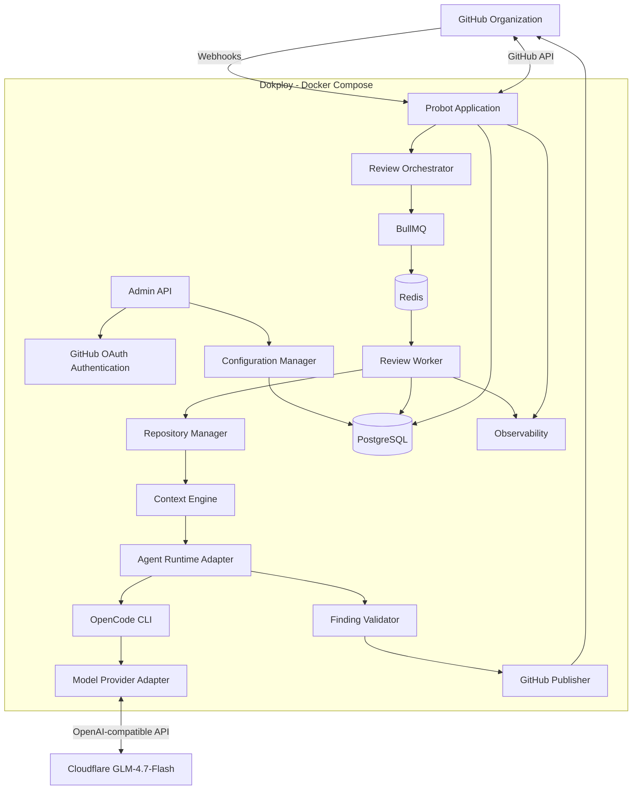
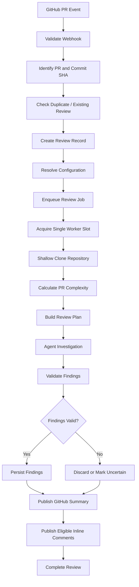
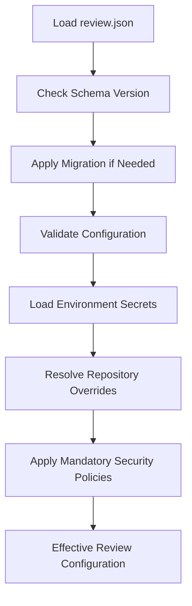

# ARCHITECTURE.md

Draft v1.0

AI-powered GitHub PR reviewer · Architecture specification · November 2026

Writing

# AI-Powered GitHub PR Reviewer

## System Architecture & Technical Design

**Document:** ARCHITECTURE.md\
**Version:** 1.0\
**Status:** Architecture baseline — ready for implementation planning\
**Deployment:** Docker Compose on Dokploy\
**Initial AI model:** Cloudflare GLM-4.7-Flash

---

# 1\. Project Overview

## 1.1 Objective

Build an AI-powered GitHub Pull Request reviewer that automatically analyzes code changes, identifies potential bugs and engineering issues, validates findings, and publishes actionable feedback directly on GitHub.

The system will integrate with GitHub through a Probot application and use an independent AI agent runtime to perform code reviews.

The system must prioritize review quality, correctness, security and maintainability.

## 1.2 Core principles

1. **Quality first:** Prefer verified, actionable findings over large numbers of speculative comments.
2. **Context-aware reviews:** Analyze more than the Git diff when necessary.
3. **Adaptive investigation:** Allocate context, tokens and review stages based on PR complexity.
4. **Runtime independence:** Do not tightly couple the application to OpenCode.
5. **Provider independence:** Support OpenAI-compatible model providers.
6. **Configuration-driven:** Make operational behavior configurable through one central JSON configuration.
7. **Secure execution:** Treat repository content and pull request changes as untrusted input.
8. **Durable processing:** Reviews must survive application restarts.
9. **Idempotency:** Avoid duplicate reviews and stale GitHub comments.
10. **Observable operations:** Track review execution, quality, resource consumption and failures.

## 1.3 Initial scope

- Multiple repositories belonging to one GitHub organization.
- GitHub App integration.
- Automatic reviews on PR opened, synchronized and ready-for-review events.
- Manual review support.
- Shallow Git clones.
- Adaptive AI investigation.
- Summary and inline GitHub comments.
- Configurable review categories and severity.
- Finding verification and confidence scoring.
- Configurable command execution.
- Central configuration management.
- Single-instance deployment.

---

# 2\. Architectural Decisions

## 2.1 Confirmed decisions

| Area | Decision |
| --- | --- |
| GitHub integration | Probot / GitHub App |
| Repository scope | Multiple organization repositories |
| Review triggers | Opened, synchronized, ready for review |
| Repository retrieval | Shallow clone |
| Review output | Summary + inline comments |
| Concurrency | One review at a time |
| Review strategy | Adaptive based on PR complexity |
| Context retrieval | Agent decides within retrieval budget |
| Model integration | OpenAI-compatible provider adapter |
| Initial model | Cloudflare GLM-4.7-Flash |
| Review categories | Configurable, all enabled by default |
| Severity | Configurable severity + confidence |
| Uncertain findings | Separate section in summary |
| Project conventions | Automatic detection + custom instructions |
| Deduplication | Configurable lifecycle management |
| Execution | Configurable execution strategy |
| Commands | Configurable allowlist |
| Tests/builds | Disabled by default; agent may request permitted commands |
| Network | Configurable domain allowlist |
| Workspace | Configurable retention and cleanup |
| Queue | Recommendation pending approval |
| Database | PostgreSQL |
| Queue backend | Redis recommended |
| Configuration | Central review.json |
| Admin authentication | GitHub OAuth restricted to organization members |
| Deployment | One Docker Compose project |
| Scaling | Single instance initially |
| Monitoring | Logs, metrics, tracing and alerts |
| Evaluation | Benchmark PRs and historical quality comparisons |

## 2.2 Recommended technology stack

| Component | Recommendation | Responsibility |
| --- | --- | --- |
| Language | Node.js + TypeScript | Application |
| GitHub integration | Probot | Webhooks and GitHub API |
| HTTP framework | Probot's underlying Express integration | Webhook and admin routes |
| Queue | BullMQ | Background job processing |
| Queue storage | Redis | Job state and scheduling |
| Database | PostgreSQL | Durable application data |
| ORM | Prisma | Database access and migrations |
| Agent runtime | OpenCode CLI initially | Agent execution |
| Agent abstraction | Custom TypeScript runtime adapter | Runtime independence |
| Model integration | OpenAI-compatible adapter | Cloudflare GLM integration |
| Validation | Zod + JSON Schema | Configuration and output validation |
| Logging | Pino | Structured logs |
| Metrics | Prometheus-compatible metrics | Operational monitoring |
| Tracing | OpenTelemetry | Distributed tracing |
| Deployment | Docker Compose | Service orchestration |
| Hosting | Dokploy | Deployment management |

The table represents recommended implementation choices, not additional user-approved decisions.

---

# 3\. High-Level Architecture

## 3.1 System architecture diagram

mermaid



## 3.2 Architectural separation

The application must be divided into the following logical components:

### Probot application

Responsibilities:

- Receive GitHub webhooks.
- Validate webhook signatures.
- Identify repository, PR and commit SHA.
- Handle GitHub App installation.
- Create review requests.
- Publish GitHub review results.
- Handle manual review requests.

Probot must not perform long-running AI inference directly inside webhook handlers.

Webhook handlers should validate, persist and enqueue work, then return promptly.

### Review orchestrator

Responsibilities:

- Create review jobs.
- Resolve repository configuration.
- Apply review policies.
- Handle duplicate events.
- Track review lifecycle.
- Coordinate job cancellation and supersession.

### Review worker

Responsibilities:

- Retrieve repository code.
- Create a review workspace.
- Calculate PR complexity.
- Invoke the agent runtime.
- Validate findings.
- Persist results.
- Publish eligible findings.

The worker is independent of Probot's webhook lifecycle.

### Agent runtime adapter

Responsibilities:

- Start and manage agent sessions.
- Provide repository tools.
- Supply model configuration.
- Enforce timeouts and execution budgets.
- Capture structured output.
- Terminate failed sessions.

The orchestrator must communicate with the runtime through a stable TypeScript interface.

### Configuration manager

Responsibilities:

- Load review.json.
- Validate settings.
- Resolve defaults.
- Resolve repository overrides.
- Manage configuration versions.
- Support reload and rollback.
- Maintain an audit history.

---

# 4\. Review Lifecycle

## 4.1 Supported GitHub events

Initial webhook events:

| Event | Action | Behavior |
| --- | --- | --- |
| pull\_request | opened | Queue review |
| pull\_request | synchronize | Supersede previous review and queue latest |
| pull\_request | ready\_for\_review | Queue review |
| issue\_comment | created | Detect authorized manual review command |
| installation | created | Register installation |
| installation | deleted | Disable affected installation |

Draft PR behavior should be configurable.

Manual command recommendation:

`/review`

The command accepts an optional **review type** argument (§4.1 review types):

| Command | Review type |
| --- | --- |
| `/review` | `github.defaultReviewType` (default: `standard`) |
| `/review type:skill` / `/review skill` | `skill` |
| `/review type:handbook` / `/review handbook` | `handbook` |
| `/review type:standard` / `/review standard` | `standard` |

Unknown or disabled types post a short help comment and are NOT ingested.
Manual commands always force a fresh review: the per-type attempt counter is
incremented (first manual run of a type is attempt 1), so all types can
review the same head SHA independently while duplicates within a type are
still deduplicated.

The command should be restricted to authorized organization members or configured repository collaborators.

### Review types (§4.1)

Three on-demand review methodologies run through the SAME adaptive engine and
strategy (`review.mode` is independent of the type):

- `standard` — the default engine and instructions.
- `skill` — injects a code-review playbook (methodology + checklists) from
  the review's own knowledge snapshot into the review prompt. The playbook
  comes only from the fetched source (`knowledge.skill`); a missing or
  unavailable playbook fails the review (`SKILL_PLAYBOOK_UNAVAILABLE`).
- `handbook` — the trusted retrieval layer ranks the review's own cached
  handbook files against the PR's detected technologies and changed paths
  (technology category match > keyword overlap; `general/` eligible but
  deprioritized) and selects content under a token budget
  (`knowledge.handbook.maxTokens`, ≈4 chars/token; `maxChars` is a
  byte-level backstop). Deterministic, deduplicated, whole-file-preferring.
  An unconfigured handbook fails the review (`HANDBOOK_UNCONFIGURED`).

Instruction profiles (trusted, application-controlled text in
`src/review-engine/prompts/`):

| mode     | profile                                                     |
|----------|-------------------------------------------------------------|
| standard | common security/scope rules (default flow, unchanged)        |
| skill    | common + skill-mode instructions + playbook (untrusted data) |
| handbook | common + handbook-mode instructions + retrieved guidelines (untrusted data) |

Handbook reviews inject the guidelines block ONCE in the analysis stage;
the investigation/reporting stages reuse it by reference (profile
instructions + a digest of the provided files) instead of re-injecting the
full text. Note: each engine stage runs as its own `opencode run` process
without shared context, so the later-stage reference also carries the
provided-files digest; full-text re-injection is avoided for token budget.

Retrieval is Option A (application-side): the agent has NO handbook tools
or permissions — deny-by-default agent permissions are unchanged — it only
receives injected text. Per-review metrics (estimated injected tokens,
documents retrieved, candidates → relevant → selected funnel, truncation
flag) are persisted on `Review.knowledgeSnapshot.metrics` and exposed
additively as `knowledgeMetrics` by the comparison endpoint.

Publishing gate (decision 7): only types with
`review.types.<type>.publish = true` post to GitHub (default: `standard`
only). Other types run, persist findings and complete normally — the skip is
recorded on the review (`publishSkipped`) and logged, and no GitHub comment
is created.

Admin API: `POST /api/admin/reviews/trigger` ingests a review of a given
type; `GET /api/admin/reviews/compare?repository=owner/repo&pr=123` returns
per-type rows (state, attempt, duration, severity counts, per-type unique
findings, token usage, publishSkipped, additive per-source knowledgeSnapshot
{ref, contentHash} and knowledgeMetrics {injectedTokens, documentsRetrieved,
candidates, relevant, selected, truncated}) for one pull request.

## 4.2 Review workflow

mermaid



## 4.3 Review states

Recommended review state machine:

- queued
- preparing
- cloning
- analyzing
- investigating
- validating
- publishing
- completed
- completed\_with\_warnings
- failed
- cancelled
- superseded

Each state transition should be persisted.

The system must never publish results for a superseded commit.

## 4.4 Commit synchronization behavior

Recommended default:

1. Review starts for commit SHA A.
2. A new commit SHA B arrives.
3. Existing review A is marked superseded.
4. Cancel A if safely possible.
5. Enqueue B.
6. Validate the current PR head SHA before publishing.
7. Reject any result that no longer matches the current SHA.

This behavior must be configurable.

## 4.5 Knowledge sources (boot-time initialization)

The code-review skill playbook (`vercel-labs/open-agents`, `.agents/skills/code-review`)
and the engineering handbook (`nativewit/engineering-handbook`) are fetched ONCE per
worker boot into a persistent cache — never per review (no GitHub API calls during a
review).

- Configuration: the `knowledge` section of `review.json` (`cacheDir`, `skill.{repo,
  ref, skillDir, maxBytes, maxTokens}`, `handbook.{repo, ref, path,
  maxBytes, maxTokens, maxChars}`). Prod MUST pin refs via env overrides `KNOWLEDGE_SKILL_REF` /
  `KNOWLEDGE_HANDBOOK_REF` (full commit SHAs); a branch-name ref is resolved to its
  current commit SHA at boot so the cache is still SHA-keyed.
- Cache layout: `<cacheDir>/skill/<sha>/…` and `<cacheDir>/handbook/<sha>/…`, each
  with a `manifest.json` `{ ref, fetchedAt, contentHash (sha256), files[{path, sha256,
  bytes}], status }`. A validated cached copy (manifest + per-file hashes match) is
  reused with no network. Writes are atomic (temp dir + rename).
- Fetch policy: ~30s deadline per source (covers bounded retries), size budgets
  (`maxBytes`), extension allowlist (`.md/.txt`, skill also `.json/.yaml`), path
  traversal rejection (no absolute paths, `..`, or symlinks) and stripping of
  config-like manifests (`opencode.json`, `*.schema.json`, …).
- Failure semantics: the worker never crashes. There is no fallback content: a
  failed source becomes `status "unavailable"` and the review types that need it fail
  fast (`SKILL_PLAYBOOK_UNAVAILABLE` / `HANDBOOK_UNAVAILABLE` /
  `HANDBOOK_UNCONFIGURED`). Standard reviews are unaffected.

Per-review reproducibility: at pipeline start the review's knowledge files are copied
into its own workspace (`<workspacePath>/knowledge/<source>/…`) and the snapshot
identity `{ ref, contentHash, files[{path, sha256}] }` is persisted on the
(`Review.knowledgeSnapshot`) and injection reads only the review's own copies, so a
worker restart refreshing the cache cannot change an in-flight review. Recovery
honors the persisted snapshot: if the boot cache no longer reproduces it (same ref
AND content hash), the review fails with `KNOWLEDGE_SNAPSHOT_UNAVAILABLE` instead of
silently re-reviewing against different knowledge. The comparison endpoint
(`/api/admin/reviews/compare`) reports each review's per-source `ref` + `contentHash`
plus the additive `knowledgeMetrics` (injectedTokens, documentsRetrieved,
candidates/relevant/selected funnel, truncated).

---

# 5\. Repository Access and Context Engineering

## 5.1 Repository retrieval

Use shallow Git clones.

The initial repository workflow:

1. Resolve base branch and PR head SHA.
2. Clone the repository with limited history.
3. Fetch the required PR commit.
4. Calculate the merge base where needed.
5. Generate the Git diff.
6. Inspect changed files.
7. Allow the agent to request additional repository context.

Do not automatically load the entire repository into the model context.

## 5.2 Context investigation strategy

The context engine should expose:

- Changed files.
- Diff hunks.
- File contents.
- Directory structure.
- Symbol references.
- Function and class definitions.
- Import relationships.
- Callers and callees.
- Interfaces and implementations.
- Related tests.
- Configuration files.
- Project conventions.

The agent decides which additional context to retrieve.

However, every retrieval must consume a configurable budget.

## 5.3 Context retrieval priority

Recommended investigation order:

1. Changed lines.
2. Complete changed functions or classes.
3. Direct dependencies.
4. Callers and callees.
5. Related interfaces and implementations.
6. Related tests.
7. Configuration and project conventions.
8. Additional files when evidence requires them.

## 5.4 Adaptive complexity scoring

Suggested complexity factors:

| Factor | Example |
| --- | --- |
| Diff size | Number of changed lines |
| Changed files | Number of modified files |
| Structural changes | New modules or refactoring |
| Dependency impact | Number of related modules |
| Risky code | Authentication, payment, authorization |
| Concurrency | Async processing and shared state |
| Data integrity | Database and transaction changes |

The complexity score should influence:

- Investigation depth.
- Maximum model calls.
- Context retrieval budget.
- Token allocation.
- Review timeout.
- Verification effort.

The scoring weights and thresholds must be configurable.

---

# 6\. AI Review Engine

## 6.1 Adaptive review strategy

The system should not always use the same number of agent passes.

Recommended stages:

### Stage 1 — Initial analysis

- Understand the PR objective.
- Inspect the Git diff.
- Identify potentially risky changes.
- Detect affected modules.
- Create an investigation plan.

### Stage 2 — Investigation

- Retrieve relevant repository context.
- Trace affected code paths.
- Inspect related tests.
- Compare existing project conventions.
- Identify concrete bugs and regressions.

### Stage 3 — Verification

- Recheck the proposed finding against source code.
- Verify the affected line.
- Determine whether the issue is real.
- Check whether the behavior is intentional.
- Evaluate severity and confidence.

### Stage 4 — Reporting

- Remove duplicates.
- Normalize findings.
- Separate verified and uncertain findings.
- Generate the PR summary.
- Generate inline review comments.

The adaptive planner can reduce or increase investigation depth according to PR complexity.

## 6.2 Review categories

All categories are enabled by default but configurable.

| Category | Description |
| --- | --- |
| Functional correctness | Incorrect logic and broken behavior |
| Regression | Existing behavior unintentionally changed |
| Security | Authentication, authorization and input validation |
| Performance | Unnecessary operations and inefficient algorithms |
| Concurrency | Race conditions and unsafe asynchronous behavior |
| Data integrity | Transactions and consistency |
| Error handling | Missing or incorrect failure handling |
| API compatibility | Breaking interface changes |
| Maintainability | Significant structural and design issues |
| Testing | Missing or insufficient relevant tests |

## 6.3 Severity and confidence

Severity and confidence must remain independent dimensions.

Recommended default severity:

- Critical
- High
- Medium
- Low
- Informational

Confidence should be represented numerically from 0 to 1.

Example:

json

```json
{
  "severity": "high",
  "confidence": 0.94
}
```

A high-severity issue with low confidence must not automatically become an inline comment.

## 6.4 Finding publication policy

Verified findings:

- Eligible for inline comments.
- Included in the PR summary.

Uncertain findings:

- Included in a separate summary section.
- Not published as ordinary inline findings by default.

No actionable findings:

- Reporting behavior is configurable.

The reviewer should never invent evidence to fill a review quota.

## 6.5 Project convention detection

The agent should inspect:

- Existing code style.
- Directory structure.
- Naming conventions.
- Error-handling patterns.
- Testing patterns.
- Existing architecture.
- Relevant documentation.
- Existing review instructions.

Custom review instructions should also be supported through configuration.

---

# 7\. Finding Validation and Lifecycle

## 7.1 Finding schema

json

```json
{
  "fingerprint": "sha256:example",
  "category": "functional",
  "severity": "high",
  "confidence": 0.94,
  "title": "Potential null dereference",
  "file": "src/services/user.ts",
  "line": 42,
  "description": "The value may be null before accessing the property.",
  "evidence": [
    "Relevant source code",
    "Affected execution path"
  ],
  "status": "new",
  "verified": true
}
```

## 7.2 Finding lifecycle

Recommended statuses:

- new
- existing
- updated
- resolved
- dismissed
- uncertain
- superseded

## 7.3 Deduplication

Use deterministic fingerprints based on:

- Repository.
- Finding category.
- Relevant code location.
- Normalized finding description.
- Affected code identity.

Avoid using line number alone because code movement can change line positions.

The system should compare previous findings when reviewing updated commits.

## 7.4 GitHub publishing

Use GitHub review comments anchored to changed lines where possible.

Inline comments must reference valid positions in the PR diff.

If a finding cannot be anchored to a changed line, include it in the summary rather than forcing an incorrect inline location.

Initial GitHub behavior:

- Publish a summary.
- Publish verified inline findings.
- Separate uncertain findings.
- Never automatically approve or request changes.

Approval automation is outside the initial scope.

---

# 8\. Agent Runtime Architecture

## 8.1 Runtime recommendation

**Recommended initial implementation: OpenCode CLI behind a custom TypeScript runtime adapter.**

Reasoning:

- Your application needs repository-aware agent execution.
- OpenCode provides an existing agent environment.
- CLI execution fits temporary review workspaces.
- Sessions can be isolated per review.
- The application can control invocation and termination.
- The runtime can be replaced without redesigning Probot.

The recommendation is conditional on validating OpenCode compatibility with the actual Cloudflare GLM endpoint and model behavior.

Do not expose OpenCode as the application's public API.

## 8.2 Runtime abstraction

typescript

```typescript
interface AgentRuntime {
  startSession(
    options: AgentSessionOptions
  ): Promise<AgentSession>;

  execute(
    session: AgentSession,
    task: AgentTask
  ): Promise<AgentResult>;

  terminate(
    session: AgentSession
  ): Promise<void>;

  healthCheck(): Promise<RuntimeHealth>;
}
```

Possible future adapters:

- OpenCode CLI.
- OpenCode server.
- Custom Node.js agent.
- Other compatible agent runtimes.

## 8.3 Session strategy

Session management must be configurable.

Recommended initial default:

- One isolated session per review.
- Independent working directory.
- Explicit token budget.
- Explicit execution timeout.
- No shared conversation state between repositories.

Separate sessions for individual review stages can be introduced if evaluation demonstrates better results.

## 8.4 Runtime failure

Your selected behavior is to fail immediately when the agent runtime or model provider is unavailable.

Distinguish this from infrastructure failures:

- Provider unavailable: fail the review.
- Invalid model response: fail validation according to policy.
- Redis failure: apply infrastructure recovery policy.
- Database failure: prevent publication and preserve recoverable state.
- Worker crash: recover through durable job state.

The provider must not silently switch models.

---

# 9\. Model Provider Integration

## 9.1 Provider abstraction

Use an OpenAI-compatible provider adapter.

Initial provider:

Cloudflare GLM-4.7-Flash.

Keep the provider endpoint and model identifier configurable.

## 9.2 Provider interface

typescript

```typescript
interface ModelProvider {
  chat(
    request: ModelRequest
  ): Promise<ModelResponse>;

  healthCheck(): Promise<ProviderHealth>;

  getCapabilities(): Promise<ModelCapabilities>;
}
```

The adapter should normalize:

- Request format.
- Response format.
- Tool calling.
- Token usage.
- Finish reasons.
- Errors.
- Timeouts.

Do not assume every OpenAI-compatible provider implements every feature identically.

## 9.3 Model configuration

Recommended initial configuration:

json

```json
{
  "provider": {
    "type": "openai-compatible",
    "baseURL": "${MODEL_BASE_URL}",
    "apiKeyEnv": "CLOUDFLARE_API_KEY",
    "model": "glm-4.7-flash",
    "temperature": 0.1,
    "maxOutputTokens": 8192,
    "timeoutMs": 120000
  }
}
```

The endpoint and model identifier must be verified against the actual Cloudflare AI Gateway or Workers AI endpoint being used.

## 9.4 Model quality evaluation

Before finalizing OpenCode, run a representative compatibility benchmark covering:

- Basic reasoning.
- Long-context retrieval.
- Structured JSON generation.
- Tool calling.
- Multi-step investigation.
- Finding verification.
- Error recovery.

A model endpoint accepting OpenAI-compatible requests does not guarantee complete agent-tool compatibility.

---

# 10\. Command Execution and Security

## 10.1 Security principle

Repository code, PR descriptions, comments, README files and source code must all be treated as untrusted input.

Prompt injection instructions found in repository content must never override system instructions, execution permissions or security policies.

## 10.2 Execution modes

Recommended configurable modes:

- read-only
- static-analysis
- sandbox

Initial default:

`static-analysis`

Tests and builds are disabled by default.

## 10.3 Command policy

The agent may request a command, but the execution policy decides whether it can run.

Example:

json

```json
{
  "execution": {
    "mode": "static-analysis",
    "commands": {
      "allowlist": [
        "git",
        "grep",
        "find"
      ],
      "allowTests": false,
      "allowBuilds": false,
      "allowPackageScripts": false
    }
  }
}
```

Command execution must be controlled outside the agent.

Avoid shell-string execution where structured argument arrays can be used.

## 10.4 Sandbox architecture

Important implementation constraint:

A Docker container is not automatically a secure sandbox.

Recommended approach:

- Probot runs in a trusted application container.
- Review orchestration runs in a separate worker process/container.
- Repository code is inspected without execution by default.
- Optional repository-controlled commands execute in a separate isolated execution environment.
- Apply CPU, memory, disk and timeout limits.
- Use non-root execution.
- Restrict filesystem access.
- Restrict outbound networking.
- Destroy the execution environment after the job.

Do not mount the host Docker socket into Probot or the AI agent.

For production command execution, prefer a dedicated sandbox service or isolated runner host. A privileged Docker socket workaround should not be treated as a security boundary.

## 10.5 Network policy

Network access must be configurable through a domain allowlist.

Recommended default:

- No arbitrary outbound access from repository execution.
- Explicitly permit required model-provider access from the trusted worker.
- Explicitly permit required GitHub API access from the trusted application.
- Keep repository execution network restrictions separate from trusted application network access.

## 10.6 GitHub credential management

Recommended approach:

1. Store the GitHub App private key in deployment secrets.
2. Keep it inside the trusted Probot/credential layer.
3. Generate short-lived installation access tokens.
4. Scope tokens to the required repository.
5. Pass only the minimum required credential to trusted Git operations.
6. Never expose the App private key or installation token to the agent.

---

# 11\. Configuration Architecture

## 11.1 Configuration principle

One global `review.json` is the source of truth for application behavior.

The configuration should cover:

- Review behavior.
- Model providers.
- Agent runtime.
- Context budgets.
- Review categories.
- Severity and confidence.
- GitHub publishing.
- Execution permissions.
- Network policies.
- Queue behavior.
- Retry behavior.
- Resource limits.
- Timeouts.
- Workspace cleanup.
- Persistence.
- Observability.
- Evaluation thresholds.

Secrets must remain outside the JSON configuration.

## 11.2 Configuration resolution

mermaid



Repository overrides must never weaken mandatory application-level security restrictions.

## 11.3 Proposed review.json

This is the initial configuration blueprint. Exact property names and supported options should be finalized through the JSON Schema implementation.

json

```json
{
  "$schema": "./schemas/review-config-v1.schema.json",
  "schemaVersion": 1,

  "application": {
    "name": "ai-pr-reviewer",
    "environment": "production",
    "timezone": "UTC"
  },

  "github": {
    "organization": "YOUR_ORGANIZATION",
    "installationScope": "organization",
    "events": [
      "opened",
      "synchronize",
      "ready_for_review"
    ],
    "manualCommand": "/review",
    "draftPullRequests": {
      "enabled": false
    },
    "permissions": {
      "readContents": true,
      "readPullRequests": true,
      "readChecks": true,
      "writePullRequests": true,
      "writeReviewComments": true
    }
  },

  "review": {
    "enabled": true,

    "triggers": {
      "automatic": true,
      "manual": true
    },

    "strategy": {
      "mode": "adaptive",
      "maxStages": 4,
      "verifyFindings": true
    },

    "categories": {
      "functional": true,
      "regression": true,
      "security": true,
      "performance": true,
      "concurrency": true,
      "dataIntegrity": true,
      "errorHandling": true,
      "apiCompatibility": true,
      "maintainability": true,
      "testing": true
    },

    "severity": [
      "critical",
      "high",
      "medium",
      "low",
      "informational"
    ],

    "confidence": {
      "minimumInline": 0.85,
      "minimumVerified": 0.80
    },

    "findings": {
      "deduplication": true,
      "trackAcrossCommits": true,
      "lifecycleManagement": true,
      "publishUncertainInSummary": true
    },

    "reporting": {
      "summary": true,
      "inlineComments": true,
      "publishCleanReview": true,
      "publishApproval": false
    },

    "conventions": {
      "detectAutomatically": true,
      "customInstructions": ""
    }
  },

  "agent": {
    "runtime": {
      "type": "opencode-cli",
      "sessionStrategy": "per-review",
      "timeoutMs": 900000
    },

    "context": {
      "adaptive": true,
      "maxFiles": 100,
      "maxRetrievalCalls": 40,
      "maxInputTokens": 60000,
      "maxOutputTokens": 8192
    },

    "tools": {
      "enabled": [
        "read_file",
        "search_code",
        "list_files",
        "inspect_symbols",
        "get_diff"
      ],
      "permissionPolicy": "allowlist"
    }
  },

  "provider": {
    "type": "openai-compatible",
    "baseURL": "${MODEL_BASE_URL}",
    "apiKeyEnv": "CLOUDFLARE_API_KEY",
    "model": "glm-4.7-flash",
    "temperature": 0.1,
    "maxOutputTokens": 8192,
    "timeoutMs": 120000,
    "failurePolicy": "fail-immediately"
  },

  "execution": {
    "mode": "static-analysis",

    "commands": {
      "allowlist": [
        "git",
        "grep",
        "find"
      ],
      "allowTests": false,
      "allowBuilds": false,
      "allowPackageScripts": false
    },

    "sandbox": {
      "enabled": false,
      "networkMode": "allowlist",
      "allowedDomains": [],
      "runAsNonRoot": true
    },

    "resources": {
      "cpuLimit": "2",
      "memoryLimit": "2Gi",
      "diskLimit": "5Gi",
      "executionTimeoutMs": 900000
    }
  },

  "repository": {
    "clone": {
      "strategy": "shallow",
      "depth": 1
    },

    "workspace": {
      "retentionHours": 0,
      "cleanupAfterReview": true
    }
  },

  "queue": {
    "concurrency": 1,

    "newCommitPolicy": "supersede",

    "retry": {
      "infrastructure": {
        "enabled": true,
        "maxAttempts": 3,
        "backoff": "exponential"
      },
      "providerUnavailable": {
        "enabled": false
      }
    }
  },

  "persistence": {
    "reviewHistoryRetentionDays": 365,
    "findingRetentionDays": 365,
    "auditRetentionDays": 365,
    "artifactRetentionDays": 30
  },

  "configuration": {
    "reloadStrategy": "manual",
    "repositoryOverrides": {
      "enabled": true,
      "allowedSections": [
        "review.categories",
        "review.severity",
        "review.reporting",
        "review.strategy"
      ]
    },
    "validation": {
      "strict": true,
      "dryRun": true
    },
    "rollbackEnabled": true
  },

  "observability": {
    "logs": {
      "level": "info",
      "format": "json"
    },
    "metrics": {
      "enabled": true
    },
    "tracing": {
      "enabled": true
    },
    "alerts": {
      "reviewFailure": true,
      "queueBacklog": true,
      "providerUnavailable": true,
      "resourceLimitExceeded": true
    }
  },

  "evaluation": {
    "enabled": true,
    "benchmarkSuite": "default",
    "trackFalsePositives": true,
    "trackPrecision": true,
    "trackReviewLatency": true,
    "minimumQualityThreshold": 0.85
  }
}
```

Note: The example uses illustrative defaults. The final schema must define every field, permitted value, range and dependency. In particular, the provider endpoint, runtime options, command names and confidence thresholds must be validated against actual implementations.

## 11.4 Configuration validation

Use strict schema validation.

Validation must cover:

- Required fields.
- Field types.
- Enum values.
- Numeric boundaries.
- Invalid combinations.
- Environment variable references.
- Execution permission conflicts.
- Repository override restrictions.

Recommended commands:

bash

```bash
npm run config:validate
npm run config:dry-run
npm run config:migrate
npm run config:rollback
```

Invalid configuration must never replace the last known-good configuration.

## 11.5 Configuration reload

The reload strategy is configurable.

Recommended implementation:

- Validate new configuration before activation.
- Apply updates atomically.
- Maintain a configuration version.
- Record an audit event.
- Keep the previous configuration available.
- Allow rollback.
- Each review captures an immutable configuration snapshot.

An already-running review should not unexpectedly change its policies halfway through execution.

---

# 12\. Queue and Job Processing

## 12.1 Queue recommendation

Use BullMQ with Redis.

Why:

- Native Node.js integration.
- Job lifecycle management.
- Configurable concurrency.
- Delayed jobs.
- Retry policies.
- Operational visibility.
- Straightforward Docker deployment.

## 12.2 Persistence model

Use PostgreSQL as the durable source of truth.

Use Redis for queue processing.

Do not rely exclusively on Redis for historical review data.

Recommended safeguards:

- Redis persistence enabled.
- PostgreSQL transaction-based job creation.
- Transactional outbox pattern for webhook-to-queue reliability.
- Idempotent job handlers.
- Startup reconciliation for incomplete reviews.

## 12.3 Idempotency

Suggested job identity:

`installation_id + repository_id + pull_request_number + head_sha + review_mode`

Duplicate webhook deliveries must not create duplicate active jobs.

## 12.4 Retry policies

Different failure classes require different policies.

| Failure | Recommended behavior |
| --- | --- |
| GitHub API transient error | Retry |
| Redis unavailable | Infrastructure recovery |
| PostgreSQL unavailable | Do not publish; recover state |
| Clone failure | Configurable retry |
| Model unavailable | Fail immediately |
| Invalid model output | Validation failure |
| Agent crash | Fail or recover according to infrastructure policy |
| Resource limit exceeded | Terminate and record failure |

---

# 13\. Database Architecture

## 13.1 Recommended entities

### installations

Stores GitHub App installation metadata.

Fields:

- id
- github\_installation\_id
- organization
- status
- created\_at
- updated\_at

### repositories

Stores registered repositories.

Fields:

- id
- github\_repository\_id
- installation\_id
- full\_name
- default\_branch
- status
- created\_at
- updated\_at

### pull\_requests

Stores PR identity and current head information.

Fields:

- id
- repository\_id
- github\_pr\_number
- head\_sha
- base\_sha
- status
- updated\_at

### reviews

Stores review executions.

Fields:

- id
- pull\_request\_id
- head\_sha
- status
- complexity\_score
- runtime
- provider
- model
- configuration\_version
- started\_at
- completed\_at
- error\_code

### findings

Stores normalized review findings.

Fields:

- id
- review\_id
- fingerprint
- category
- severity
- confidence
- title
- description
- file\_path
- line\_number
- verification\_status
- lifecycle\_status
- created\_at

### review\_comments

Stores GitHub comment publication state.

Fields:

- id
- finding\_id
- github\_comment\_id
- comment\_type
- published\_at
- status

### configuration\_versions

Stores validated configuration history.

Fields:

- id
- schema\_version
- version
- configuration\_hash
- configuration\_json
- created\_by
- created\_at

### review\_jobs

Stores durable job lifecycle information.

Fields:

- id
- review\_id
- queue\_job\_id
- status
- attempts
- last\_error
- created\_at
- updated\_at

### audit\_logs

Stores administrative and security events.

Fields:

- id
- actor
- action
- resource
- metadata
- created\_at

### evaluation\_runs

Stores benchmark and quality evaluation results.

Fields:

- id
- benchmark\_id
- provider
- model
- runtime
- configuration\_version
- precision
- recall
- false\_positive\_rate
- latency
- created\_at

## 13.2 Database principles

- Use PostgreSQL transactions for state transitions.
- Add unique constraints for idempotency.
- Index repository, PR, SHA and review status.
- Store configuration snapshots per review.
- Avoid storing unnecessary repository source code permanently.
- Apply configurable retention and cleanup policies.
- Never store API credentials in review records.

---

# 14\. GitHub Integration and Permissions

## 14.1 GitHub App permissions

The selected permissions are:

- Read repository contents.
- Read pull requests.
- Read checks.
- Write pull request reviews and comments.

Implementation must verify the exact GitHub App permission mapping for the APIs used.

Additional permissions must not be requested unless an implemented feature requires them.

## 14.2 OAuth administration

Admin authentication:

GitHub OAuth restricted to organization members.

Recommended flow:

1. User authenticates through GitHub.
2. Application validates the OAuth callback.
3. Application verifies the user's organization membership.
4. Application checks configured admin authorization.
5. Application creates a secure session.
6. Admin requests are authorized using the session.

Organization membership alone should not automatically grant every user administrative privileges.

Use a configurable admin allowlist or organization-role policy.

Recommended controls:

- Secure, HttpOnly and SameSite cookies.
- CSRF protection.
- Session expiration.
- Rate limiting.
- Audit logs.
- Authorization checks.
- HTTPS only.

The GitHub App installation identity and the admin OAuth identity must remain separate.

---

# 15\. Admin API

Recommended initial endpoints:

| Method | Endpoint | Purpose |
| --- | --- | --- |
| GET | /health | Health check |
| GET | /ready | Readiness check |
| GET | /api/admin/config | Read configuration |
| POST | /api/admin/config/validate | Validate configuration |
| POST | /api/admin/config/dry-run | Test proposed changes |
| PUT | /api/admin/config | Update configuration |
| POST | /api/admin/config/reload | Reload configuration |
| POST | /api/admin/config/rollback | Restore previous version |
| GET | /api/admin/reviews | List reviews |
| GET | /api/admin/reviews/:id | Review details |
| POST | /api/admin/reviews/:id/retry | Retry eligible failures |
| POST | /api/admin/reviews/:id/cancel | Cancel review |
| GET | /api/admin/metrics | Operational metrics |
| GET | /api/admin/audit-logs | Audit history |

All administrative endpoints require authentication and authorization.

Do not expose configuration write endpoints without CSRF protection, audit logging and strict validation.

## 15.1 Admin HTML panel

The primary administrative interface is a **server-rendered HTML panel**
served directly by the Probot Node.js application — no React, no Next.js, no
separate frontend application, no additional Docker service.

- Templates: Nunjucks or EJS. Styling: plain CSS or Pico.css. Ordinary HTML
  forms with POST requests; no SPA.
- Sections: General · AI Model · Review Rules · Execution · GitHub · Storage.
- Actions: Save, Validate, Reload, Rollback.
- Authentication reuses the GitHub OAuth flow of §14.2 (org-restricted
  administrators); unauthenticated requests redirect to login.
- Every configuration change is validated against the JSON schema (§11.4);
  validation errors render beside the relevant settings.
- The current configuration version is displayed.
- API keys and secrets are never rendered — only redacted representations
  (e.g. the env var name a key is read from).
- Sensitive execution-policy changes require an explicit confirmation step
  before being applied.
- Every panel-applied change is recorded in the audit history, which is
  viewable in the panel.
- **Writes never touch `review.json` directly.** The panel submits to a
  configuration service that validates the new version, atomically persists
  it, records audit history and then activates it. This prevents concurrent
  updates from corrupting configuration.

---

# 16\. Observability and Monitoring

## 16.1 Structured logging

Use Pino.

Every review log should include:

- review\_id
- job\_id
- repository
- pull\_request\_number
- head\_sha
- runtime
- provider
- model
- stage
- duration

Never log secrets, tokens or private keys.

## 16.2 Metrics

Recommended metrics:

- reviews\_started\_total
- reviews\_completed\_total
- reviews\_failed\_total
- review\_duration\_seconds
- queue\_wait\_seconds
- queue\_depth
- findings\_total
- findings\_by\_severity
- uncertain\_findings\_total
- provider\_latency\_seconds
- provider\_errors\_total
- input\_tokens\_total
- output\_tokens\_total
- workspace\_disk\_usage
- worker\_memory\_usage

## 16.3 Tracing

Use OpenTelemetry.

Trace the following lifecycle:

Webhook received → Job created → Worker started → Clone completed → Agent started → Model request → Finding validation → GitHub publishing.

## 16.4 Alerts

Recommended alerts:

- Queue backlog.
- Repeated review failures.
- Provider unavailable.
- GitHub API authentication failures.
- Database connectivity failures.
- Redis connectivity failures.
- Worker resource exhaustion.
- Disk space approaching limit.

---

# 17\. Backup and Recovery

## 17.1 Persistent storage

Use Docker named volumes for:

- PostgreSQL.
- Redis.
- Review artifacts and temporary application data where persistence is necessary.

Temporary workspaces should have a separate cleanup policy.

## 17.2 Backup strategy

Implement configurable scheduled backups.

Recommended:

- Daily PostgreSQL backup.
- Configurable backup retention.
- Redis persistence for queue recovery.
- Backup integrity verification.
- Periodic restore testing.
- Off-host backup copies.

Important: Docker named volumes are persistent across container recreation, but they are not backups.

A production backup must survive loss of the Dokploy host.

## 17.3 Recovery strategy

On application startup:

1. Connect to PostgreSQL.
2. Connect to Redis.
3. Validate current configuration.
4. Identify incomplete review records.
5. Reconcile durable jobs with queue state.
6. Identify stale worker sessions.
7. Recover or fail incomplete reviews according to policy.
8. Resume normal processing.

---

# 18\. Docker Compose and Dokploy Deployment

## 18.1 Deployment model

One Docker Compose project containing:

- Probot application.
- Review worker.
- Redis.
- PostgreSQL.

The worker and Probot may share application code but should run as separate processes or containers.

OpenCode should be available to the worker through the runtime integration.

## 18.2 Recommended service topology

text

```text
Dokploy
  |
  +-- ai-pr-reviewer
        |
        +-- probot
        |
        +-- review-worker
        |
        +-- redis
        |
        +-- postgres
```

## 18.3 Compose blueprint

The following is a structural starting point. Pin and validate image versions before production deployment.

yaml

```yaml
services:

  probot:
    build:
      context: .
      dockerfile: Dockerfile
    command: npm run start:probot
    restart: unless-stopped
    env_file:
      - .env
    depends_on:
      postgres:
        condition: service_healthy
      redis:
        condition: service_healthy
    networks:
      - internal
      - dokploy-network

  worker:
    build:
      context: .
      dockerfile: Dockerfile
    command: npm run start:worker
    restart: unless-stopped
    env_file:
      - .env
    depends_on:
      postgres:
        condition: service_healthy
      redis:
        condition: service_healthy
    volumes:
      - review-workspaces:/app/workspaces
    networks:
      - internal

  postgres:
    image: postgres:17
    restart: unless-stopped
    environment:
      POSTGRES_DB: reviewer
      POSTGRES_USER: reviewer
      POSTGRES_PASSWORD: ${POSTGRES_PASSWORD}
    volumes:
      - postgres-data:/var/lib/postgresql/data
    healthcheck:
      test:
        - CMD-SHELL
        - pg_isready -U reviewer -d reviewer
      interval: 10s
      timeout: 5s
      retries: 5
    networks:
      - internal

  redis:
    image: redis:7
    restart: unless-stopped
    command:
      - redis-server
      - --appendonly
      - "yes"
    volumes:
      - redis-data:/data
    healthcheck:
      test: ["CMD", "redis-cli", "ping"]
      interval: 10s
      timeout: 5s
      retries: 5
    networks:
      - internal

volumes:
  postgres-data:
  redis-data:
  review-workspaces:

networks:
  internal:
    internal: true

  dokploy-network:
    external: true
```

This Compose file is a blueprint, not a deployment-ready artifact.

Before deployment:

- Confirm the actual Dokploy ingress network name.
- Configure the Probot service's public domain and HTTPS.
- Keep PostgreSQL and Redis private.
- Do not expose database ports publicly.
- Configure resource limits.
- Add non-root users.
- Configure read-only filesystems where possible.
- Add a separate secure sandbox strategy before enabling untrusted command execution.
- Configure container health and readiness.
- Use pinned image versions and production secrets.

The admin API can initially run within the Probot application while remaining logically separated through authentication and route policies.

## 18.4 Resource management

Worker limits must be configurable.

Initial example:

- CPU: 2 cores.
- Memory: 2 GB.
- Disk: 5 GB per review workspace.
- Review timeout: 15 minutes.

These are starting values, not benchmarked production requirements.

With concurrency set to one, worker resource requirements can be measured before increasing capacity.

---

# 19\. Review Quality Evaluation

Review quality is a first-class architectural concern.

A successful API call does not mean a successful code review.

## 19.1 Benchmark system

Create a benchmark repository or collection of representative PRs.

Include:

- Known functional bugs.
- Security issues.
- Regression scenarios.
- Concurrency issues.
- Performance problems.
- False-positive traps.
- Refactoring-only changes.
- Clean PRs with no actionable findings.

Each benchmark should contain expected findings and their severity.

## 19.2 Evaluation metrics

Track:

| Metric | Meaning |
| --- | --- |
| Precision | Percentage of reported findings that are valid |
| Recall | Percentage of known issues detected |
| False-positive rate | Incorrect findings |
| Severity accuracy | Correctness of impact classification |
| Line accuracy | Whether comments identify the correct location |
| Duplicate rate | Repeated findings |
| Review latency | Time to complete review |
| Context efficiency | Useful context relative to tokens consumed |

## 19.3 Historical comparisons

Store evaluation results by:

- Model.
- Provider.
- Agent runtime.
- Configuration version.
- Prompt version.
- Benchmark version.

This allows future comparison when changing from GLM to another model or changing the agent runtime.

## 19.4 Quality gates

Do not automatically approve PRs based on an unvalidated quality score.

Initially use evaluation results for internal monitoring.

Quality thresholds should be configurable and validated against benchmark results.

---

# 20\. Recommended Project Structure

text

```text
ai-pr-reviewer/
│
├── apps/
│   ├── probot/
│   │   ├── handlers/
│   │   ├── routes/
│   │   └── index.ts
│   │
│   ├── worker/
│   │   ├── processors/
│   │   ├── lifecycle/
│   │   └── index.ts
│   │
│   └── admin/
│       ├── auth/
│       ├── controllers/
│       └── middleware/
│
├── packages/
│   ├── review-engine/
│   │   ├── planner/
│   │   ├── analysis/
│   │   ├── verification/
│   │   └── reporting/
│   │
│   ├── agent-runtime/
│   │   ├── interfaces/
│   │   ├── opencode/
│   │   └── session-manager/
│   │
│   ├── model-providers/
│   │   ├── interfaces/
│   │   └── openai-compatible/
│   │
│   ├── context-engine/
│   │   ├── git/
│   │   ├── retrieval/
│   │   └── symbols/
│   │
│   ├── execution/
│   │   ├── policies/
│   │   ├── command-runner/
│   │   └── sandbox/
│   │
│   ├── github/
│   ├── configuration/
│   ├── database/
│   ├── queue/
│   ├── observability/
│   └── shared/
│
├── config/
│   ├── review.json
│   └── schemas/
│       └── review-config-v1.schema.json
│
├── prisma/
│   ├── schema.prisma
│   └── migrations/
│
├── benchmarks/
│   ├── fixtures/
│   ├── expected-findings/
│   └── evaluation/
│
├── scripts/
│   ├── config-validate.ts
│   ├── config-migrate.ts
│   └── config-rollback.ts
│
├── tests/
│   ├── unit/
│   ├── integration/
│   └── e2e/
│
├── Dockerfile
├── docker-compose.yml
├── .env.example
├── package.json
└── ARCHITECTURE.md
```

---

# 21\. Implementation Roadmap

Implement the project in independent phases.

## Phase 1 — Infrastructure and GitHub integration

- Create Node.js TypeScript project.
- Configure Probot.
- Register GitHub App.
- Implement webhook verification.
- Implement PR event handling.
- Implement PostgreSQL.
- Implement Redis and BullMQ.
- Implement durable job records.

**Acceptance criteria:** A GitHub PR event creates exactly one durable review job.

## Phase 2 — Repository management

- Implement shallow clone.
- Retrieve PR diff.
- Create temporary workspace.
- Retrieve changed files.
- Implement cleanup.
- Add commit SHA validation.

**Acceptance criteria:** A review worker can retrieve the exact PR revision and clean up the workspace.

## Phase 3 — Model integration

- Implement OpenAI-compatible provider adapter.
- Configure Cloudflare GLM-4.7-Flash.
- Validate structured responses.
- Implement token usage tracking.
- Test tool-calling compatibility.

**Acceptance criteria:** The application can invoke the configured model and receive validated structured output.

## Phase 4 — Agent runtime

- Implement runtime interface.
- Integrate OpenCode CLI.
- Implement session management.
- Implement agent timeouts.
- Implement permission policies.
- Test model/runtime compatibility.

**Acceptance criteria:** An agent can inspect a repository and return structured findings without accessing unauthorized resources.

## Phase 5 — Review intelligence

- Implement adaptive review planner.
- Implement context retrieval.
- Implement project convention detection.
- Implement finding verification.
- Implement confidence scoring.
- Implement deduplication.

**Acceptance criteria:** The engine can produce evidence-backed findings and distinguish uncertain findings.

## Phase 6 — GitHub reporting

- Implement PR summary.
- Implement inline comments.
- Implement finding lifecycle.
- Implement stale SHA protection.
- Implement manual review command.

**Acceptance criteria:** A valid review is published once, with correctly positioned inline comments and a summary.

## Phase 7 — Configuration system

- Implement review.json.
- Implement JSON Schema.
- Implement strict validation.
- Implement repository overrides.
- Implement configuration versioning.
- Implement reload and rollback.
- Implement admin API.

**Acceptance criteria:** Operational settings can be changed without application code modifications, subject to validation and reload policy.

## Phase 8 — Security and operational hardening

- Implement GitHub OAuth administration.
- Implement organization membership verification.
- Implement credential isolation.
- Implement command allowlisting.
- Implement isolated sandbox integration before enabling repository-controlled execution.
- Implement resource limits.
- Implement network policies.
- Implement audit logging.

**Acceptance criteria:** Repository-controlled code cannot access application secrets or the host environment.

## Phase 9 — Observability and evaluation

- Implement structured logs.
- Implement metrics.
- Implement tracing.
- Implement alerting.
- Implement benchmark suite.
- Implement quality metrics.
- Implement historical comparisons.

**Acceptance criteria:** Review quality and operational reliability can be measured over time.

## Phase 10 — Dokploy deployment

- Build production Docker images.
- Create Compose deployment.
- Configure persistent volumes.
- Configure HTTPS and ingress.
- Configure backups.
- Configure health checks.
- Test restart recovery.
- Test deployment rollback.

**Acceptance criteria:** The complete system operates reliably after container restarts and can restore durable review state.

---

# 22\. Outstanding Architectural Decisions

These items must be explicitly validated before or during implementation.

| Decision | Current recommendation | Status |
| --- | --- | --- |
| Agent runtime | OpenCode CLI adapter | Recommended, benchmark required |
| Queue | BullMQ + Redis | Recommended |
| ORM | Prisma | Recommended |
| Model endpoint | Cloudflare OpenAI-compatible endpoint | Must verify exact endpoint |
| Sandbox | Dedicated isolated runner | Design required before command execution |
| Configuration reload | Manual or controlled reload initially | Final selection pending |
| Repository override schema | Allowlisted sections | Final schema pending |
| Admin role policy | OAuth + organization membership + admin allowlist | Implementation pending |
| Backup destination | Off-host storage | Provider selection pending |
| Evaluation thresholds | Benchmark-derived | Baseline pending |

---

# 23\. Non-Goals for Initial Release

The first release will not attempt to implement:

- Multi-organization public SaaS onboarding.
- Multi-server horizontal scaling.
- Automatic PR approvals.
- Automatic merge operations.
- Unrestricted shell execution.
- Unrestricted repository network access.
- Multiple simultaneously running reviews.
- Autonomous model switching.
- Complex multi-agent orchestration.

These can be reconsidered after the initial system is stable and measured.

---

# 24\. Final Architecture Recommendation

The recommended initial architecture is:

**Probot + BullMQ + Redis + PostgreSQL + TypeScript Review Engine + OpenCode CLI Adapter + Cloudflare GLM-4.7-Flash.**

The Probot application receives GitHub events and creates durable review jobs. A separate worker clones the repository, retrieves context and invokes the agent runtime. The agent uses the configured model provider to investigate and verify potential issues. A validation layer filters findings before the GitHub publisher creates inline comments and the PR summary.

All operational behavior is controlled through a versioned central JSON configuration.

The agent runtime, model provider and execution environment remain independent abstractions.

The initial deployment runs as one Docker Compose project on Dokploy, with one active review at a time.

**Most important implementation rule:** Do not allow the AI agent to become the security boundary. The application must independently enforce permissions, resource limits, network restrictions, credentials and publication policies.

---

# 25\. Definition of Done

The initial production release is complete when:

- [ ]GitHub App installation works for organization repositories.
- [ ]Webhooks are authenticated and idempotent.
- [ ]PR events generate durable review jobs.
- [ ]Shallow repository cloning works.
- [ ]The worker processes one review at a time.
- [ ]GLM-4.7-Flash works through the provider adapter.
- [ ]Agent runtime is replaceable through an interface.
- [ ]Context retrieval is adaptive and budget-controlled.
- [ ]Findings have severity and confidence.
- [ ]Uncertain findings are separated from verified findings.
- [ ]Duplicate findings are tracked.
- [ ]GitHub summary and inline comments work.
- [ ]Stale reviews cannot publish outdated results.
- [ ]Command execution is restricted.
- [ ]Application secrets are isolated.
- [ ]Configuration validation and rollback work.
- [ ]GitHub OAuth admin authentication works.
- [ ]Database backups and restoration are tested.
- [ ]Monitoring and alerts work.
- [ ]Benchmark evaluations are available.
- [ ]Docker Compose deploys successfully through Dokploy.
- [ ]Restart recovery has been tested.

---